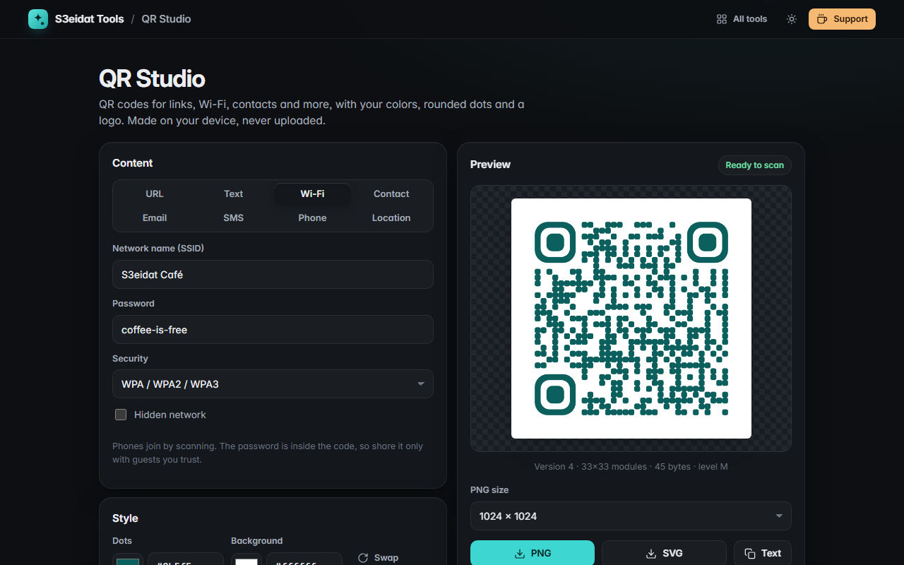

# QR Studio

> Custom QR codes for links, Wi-Fi, contacts and more. Free, private, and it runs entirely in your browser.

### ▶ [Open QR Studio](https://s3eidat.github.io/qr-studio/)



## Features

- **8 types**: URL, text, Wi-Fi (WPA/WEP/open, hidden networks), contact card (vCard 3.0), email, SMS, phone call, map location
- **Your colors**, with a contrast check that warns when a code may not scan (and for inverted light-on-dark codes)
- **Shapes**: square, rounded or dot modules, with matching rounded finder eyes
- **Error correction** L / M / Q / H and an adjustable quiet margin
- **Center logo**: error correction is locked to H and the modules under the logo are cleared, so the code still scans
- Live preview with version, module count and byte size
- Download **PNG** (256 to 2048 px) or **SVG** (vector, for print); copy the encoded text
- Full UTF-8, so Arabic and emoji work

## Privacy

Everything you type stays on your device. There is no server, no account, no analytics, and no
"dynamic QR" redirect: the code contains exactly your content and nothing else. The page ships with a strict
Content-Security-Policy (`connect-src 'self'`), so the browser itself blocks any attempt to send data anywhere.
Only your style choices (colors, shape, size) are remembered in this browser.

## Run it yourself

It's plain HTML, CSS and JavaScript with no build step:

```bash
git clone https://github.com/s3eidat/qr-studio
cd qr-studio
python -m http.server 8000
```

Then open http://localhost:8000.

## Credits

QR matrix encoding by [qrcode-generator](https://github.com/kazuhikoarase/qrcode-generator) (Kazuhiko Arase, MIT), shipped in `lib/`.

## Support

If this saved you time, **[buy me a coffee ☕](https://s3eidat.github.io/coffee/)**. It keeps every tool free.

---

Part of **[S3eidat Tools](https://s3eidat.github.io/)**: 100+ free, private tools that run in your browser. MIT licensed.
